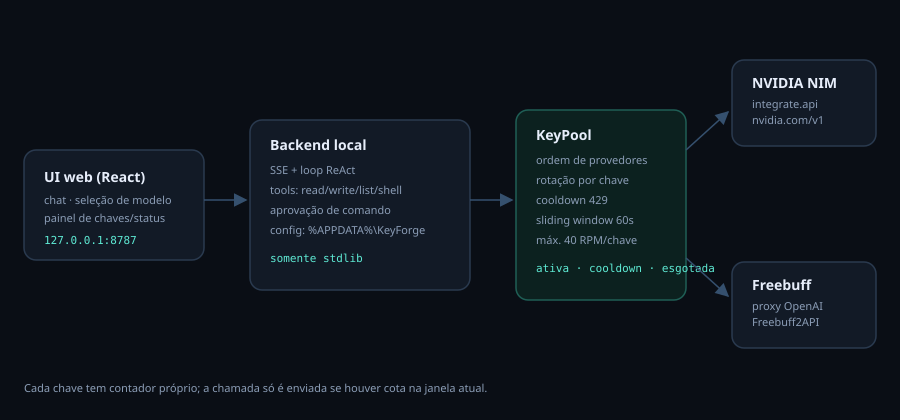

# KeyForge — agente de programação com pool de chaves

Agente de código com **interface web** (estilo chat/IDE, sem terminal), que gerencia um pool
de várias chaves de API de **sete provedores** — NVIDIA NIM, Freebuff, OpenAI, Google Gemini,
DeepSeek, OpenRouter e Anthropic (via proxy local) — com **rotação automática por limite de uso**,
**rate limiter global compartilhado entre instâncias**, **health check por modelo** e
**seletor de modelo** por provedor. Distribuído como **app desktop Electron** com instalador
`.exe` para Windows (electron-builder), com configurações preservadas em
`%APPDATA%\KeyForge\config.json`.



## Screenshots

> **Placeholders** — adicione as capturas reais em `docs/screenshots/` e troque a tabela por
> imagens Markdown (``), por exemplo.

| Tela | Arquivo sugerido |
|---|---|
| Chat com ferramentas e aprovação de shell | `docs/screenshots/chat.png` |
| Pool de chaves / status dos provedores | `docs/screenshots/keys.png` |
| Seletor de modelo + health check | `docs/screenshots/models.png` |
| Configurações (ordem, RPM, concorrência) | `docs/screenshots/settings.png` |

### Instalação rápida

1. Baixe o instalador mais recente em **`https://github.com/<seu-usuario>/keyforge/releases/latest`**
   (substitua `<seu-usuario>` depois de publicar) **ou** compile com `npm install && npm run build`
   e `npm run dist`.
2. Execute `KeyForge-Setup-1.1.0.exe` e abra o **KeyForge** pelo atalho.
3. Cadastre pelo menos uma chave em **Pool de chaves → + adicionar chave**.
4. Escolha o modelo na barra superior e comece a conversar.

---

---

## 1. O que está incluído

| Requisito | Como foi entregue |
|---|---|
| UI web (React) | `frontend/` — chat, painel de chaves/status, modal de configurações, seletor de modelo |
| Pool multi-provedor | `backend/agent_core/keypool.py` — rotação por ordem de provedores e por chave |
| 7 provedores | NVIDIA, Freebuff, OpenAI, Google Gemini, DeepSeek, OpenRouter e Anthropic (proxy) |
| Cooldown / esgotada | estado por chave com `cooldownUntil` e `exhausted`, visível na UI em tempo real |
| Rate limiter global | `ratestate.py` — sliding window de 60s por `provedor::chave`, arquivo compartilhado + lock, verificado **antes** de enviar |
| Health check | `health.py` — teste mínimo por modelo, filtro do seletor e fallback automático |
| Seletor de modelo | dropdown agrupado por provedor + modo “Automático” (segue a ordem de provedores) |
| Loop ReAct + tools | `backend/agent_core/agent.py` — `read_file`, `write_file`, `list_directory`, `run_shell` |
| Confirmação de shell | evento `approval_required` no SSE + endpoint `/api/approvals/{id}` |
| App desktop | `electron/main.js` — inicia o backend, espera a porta 8787 e abre a janela; encerra o Python ao fechar |
| Instalador `.exe` | `electron-builder` (NSIS x64) → `dist-electron\KeyForge-Setup-1.1.0.exe` |
| Config preservada | `%APPDATA%\KeyForge\config.json` — fora da pasta de instalação e no `.gitignore` |

Stack: **Python 3.10+** (backend, apenas biblioteca padrão) + **React 19/Vite** (frontend) +
**Electron 33 + electron-builder** (app desktop/instalador) + **PyInstaller** (backend `.exe`).

---

## 2. Estrutura do repositório

```
backend/
  agent_core/
    app.py          # entrypoint: sobe o servidor (--no-browser para Electron)
    server.py       # HTTP + SSE (somente stdlib)
    agent.py        # loop ReAct, tool calling, aprovações
    keypool.py      # rotação, cooldown, fallback, status
    ratelimit.py    # sliding window 60s por chave
    ratestate.py    # cota global compartilhada + lock entre processos
    health.py       # health check por modelo
    providers.py    # cliente OpenAI-compatible (streaming)
    tools.py        # ferramentas + sandbox de workspace
    config.py       # templates dos provedores / config.json
  keyforge_launcher.py  # entrypoint do PyInstaller
  tests/                # pytest: rotação, RPM, sandbox, fluxo completo
electron/
  main.js               # janela, spawn/health check/kill do backend
  preload.js            # ponte segura (contextBridge)
frontend/
  src/App.jsx, src/api.js, src/components/*, src/styles.css
package.json            # scripts npm + config do electron-builder
installer/keyforge.iss  # instalador Inno legado (abre no navegador)
scripts/build.ps1       # frontend + PyInstaller (+ instalador legado com -Installer)
scripts/dev.ps1         # backend 8787 + Vite 5173
LICENSE                 # MIT
```

---

## 3. Setup para desenvolvimento

Pré-requisitos: **Python 3.10+** e **Node.js 20+**.

### 3.1 App desktop (Electron)

```powershell
npm install          # Electron + electron-builder + dependências do frontend
npm run build        # frontend + dist\keyforge-backend.exe (cria .venv e usa PyInstaller)
npm start            # abre a janela do KeyForge
```

O `main.js` sobe o `keyforge-backend.exe` com `--no-browser`, aguarda
`http://127.0.0.1:8787/api/health` responder e só então abre a janela. Fechar a janela encerra o
backend (no Windows via `taskkill /PID … /T /F`). O log do processo fica em
`%APPDATA%\KeyForge\logs\electron-backend.log`.

Se você já tem um backend do KeyForge rodando em 8787, o Electron o reutiliza e não o encerra ao
sair. Para gerar o instalador: `npm run dist` (veja a seção 9).

### 3.2 Modo web (desenvolvimento)

```powershell
# 1) dependências do backend (o runtime não tem dependências externas)
python -m venv .venv
.\.venv\Scripts\python.exe -m pip install -r backend\requirements-dev.txt

# 2) frontend
cd frontend
npm install
cd ..

# 3) backend (porta 8787) + Vite (porta 5173)
.\scripts\dev.ps1
# alternativas:
#   backend: cd backend; ..\.venv\Scripts\python.exe -m agent_core.app --port 8787 --no-browser
#   frontend: cd frontend; npm run dev
```

Abra **http://127.0.0.1:5173** durante o desenvolvimento (o Vite faz proxy de `/api` para 8787).
Para rodar como em produção no navegador (tudo servido pelo backend), gere o frontend e abra
**http://127.0.0.1:8787**:

```powershell
cd frontend; npm run build; cd ..
cd backend; ..\.venv\Scripts\python.exe -m agent_core.app
```

O backend escuta **somente em 127.0.0.1** e escolhe a primeira porta livre a partir de 8787.
Nenhum dado sai da máquina, exceto as chamadas aos provedores configurados.

---

## 4. Subir o proxy Freebuff2API

O KeyForge fala com **qualquer proxy compatível com OpenAI**. O mais usado para Freebuff é o
[Quorinex/Freebuff2API](https://github.com/Quorinex/Freebuff2API) (Go, com rotação de
`AUTH_TOKENS`), normalmente em `http://127.0.0.1:8080/v1` — confira o README do repositório
para a versão/flags atuais.

```powershell
git clone https://github.com/Quorinex/Freebuff2API
cd Freebuff2API

# opção A — Docker
docker compose up -d

# opção B — Go
# crie um .env (ou exporte as variáveis) com os tokens de autenticação do Freebuff:
#   AUTH_TOKENS=token1,token2,token3
#   PORT=8080
go run .
```

Verifique antes de seguir:

```powershell
curl http://127.0.0.1:8080/v1/models
```

**Dois modos de uso no KeyForge** (o painel trata os dois):

1. **O proxy rotaciona internamente** (`AUTH_TOKENS=...` no proxy): cadastre **uma** chave
   Freebuff no KeyForge com valor vazio ou `not-needed`. O KeyForge envia 1 requisição e o
   proxy escolhe o token.
2. **Uma chave KeyForge por token do proxy**: use 3 tokens como 3 chaves — o KeyForge rotaciona
   entre elas e mantém contador de uso por chave, como pedido (“3 Freebuff + 4 NVIDIA”).

Em ambos os casos, o campo **Base URL** do provedor deve apontar para `http://127.0.0.1:8080/v1`.

---

## 5. Cadastrar as chaves (todos os provedores)

1. Abra a interface e, no painel **Pool de chaves** (lateral esquerda), clique em
   **“+ adicionar chave”** no bloco **NVIDIA NIM**:
   - `nome`: `nvidia-conta-1` … `nvidia-conta-4`
   - `chave`: a API key da conta (gerada em `build.nvidia.com` → *API Keys*)
   - repita para as 4 contas. Cada chave tem contador, janela de RPM e status próprios.
2. No bloco **Freebuff (proxy)**, cadastre as 3 chaves (nomes `fb-1`…`fb-3`). Se o proxy
   rotaciona sozinho, cadastre uma única chave vazia.
3. Use **“testar”** em cada chave (valida via `GET /v1/models`) e **“sincronizar modelos”**
   para popular o seletor com os modelos realmente disponíveis naquele provedor.

As chaves são gravadas apenas em `%APPDATA%\KeyForge\config.json` e **nunca** voltam para o
navegador em texto puro — a API devolve somente a versão mascarada (`nvapi-…a1b2`).

### 5.1 OpenAI, Google, DeepSeek, OpenRouter e Anthropic

Todos os provedores aparecem no mesmo painel, com **+ adicionar chave**, **testar**,
**remover** e **sincronizar modelos**. O fluxo é sempre o mesmo: adicione a chave, clique em
**testar** e depois em **sincronizar modelos** para trazer o catálogo real de `/v1/models`.

| Provedor | Base URL padrão | Modelos iniciais | Onde obter a chave |
|---|---|---|---|
| **OpenAI** | `https://api.openai.com/v1` | `gpt-4o`, `gpt-4o-mini` | platform.openai.com → *API keys* (`sk-…`) |
| **Google Gemini** | `https://generativelanguage.googleapis.com/v1beta/openai` | `gemini-2.5-pro`, `gemini-2.5-flash` | aistudio.google.com → *API key* (`AIza…`) |
| **DeepSeek** | `https://api.deepseek.com/v1` | `deepseek-chat`, `deepseek-reasoner` | platform.deepseek.com → *API keys* (`sk-…`) |
| **OpenRouter** | `https://openrouter.ai/api/v1` | `openai/gpt-4o-mini`, `openai/gpt-4o`, `anthropic/claude-sonnet-4.5`, `google/gemini-2.5-flash` | openrouter.ai/keys (`sk-or-v1-…`) |
| **Anthropic** | `http://127.0.0.1:8082/v1` | `claude-sonnet-4-5`, `claude-haiku-4-5` | proxy local (veja abaixo) |

- **OpenAI** — crie a chave em `platform.openai.com/api-keys` e cole no painel. A Base URL já vem
  correta; o campo **sincronizar modelos** lista os modelos liberados para a conta.
- **Google Gemini** — use uma chave do Google AI Studio. O endpoint é o **modo compatível com
  OpenAI** do Gemini; mantenha o `/v1beta/openai` na Base URL (o KeyForge não acrescenta `/v1`
  quando já existe um caminho explícito). O `rpmLimit` padrão é 10 para não estourar o free tier —
  ajuste em **⚙ Configurações** conforme seu plano.
- **DeepSeek** — chave em `platform.deepseek.com`; `deepseek-reasoner` devolve raciocínio e
  `deepseek-chat` é o modelo geral.
- **OpenRouter** — a chave começa com `sk-or-v1-`. Os modelos usam o formato `vendor/modelo`;
  **sincronizar modelos** substitui a lista inicial pelo catálogo completo da sua conta. Você
  também pode editar `defaultModel` nas Configurações.
- **Anthropic (proxy local)** — a API da Anthropic não fala o formato OpenAI, então o KeyForge
  aponta para um proxy de tradução. O exemplo abaixo usa o **Vandamme Proxy** (projeto de
  terceiros; confira os comandos/flags da versão instalada):

  ```powershell
  python -m pip install vandamme-proxy
  $env:ANTHROPIC_API_KEY = "sk-ant-..."
  $env:VDM_DEFAULT_PROVIDER = "anthropic"
  vdm server start --host 127.0.0.1 --port 8082
  ```

  Confirme que o proxy está no ar antes de testar:

  ```powershell
  curl http://127.0.0.1:8082/v1/models
  ```

  No KeyForge, o provedor **Anthropic (proxy local)** já aponta para
  `http://127.0.0.1:8082/v1`. A chave da Anthropic fica **no proxy**; se ele não exigir token do
  cliente, adicione uma chave com o campo vazio (o backend permite chave vazia para provedores
  em loopback, como Freebuff e Anthropic). Se o proxy usar os prefixos `anthropic:`, ajuste o
  modelo padrão para o alias correspondente.

O **rate limiter global** e o **health check** usam o mesmo caminho para todos os provedores: cada
chave tem sua janela de 60s (`rpmLimit`), e o botão **Testar Todos os Modelos** percorre o catálogo
de cada provedor que tenha pelo menos uma chave.

---

## 6. Como funciona a rotação

Ordem configurável em **⚙ Configurações → Ordem de preferência** (padrão: NVIDIA → Freebuff →
OpenAI → Google → DeepSeek → OpenRouter → Anthropic). O botão `⇄` na barra superior inverte a
ordem com um clique.

Para cada requisição do agente:

1. percorre as chaves do provedor preferido **na ordem cadastrada**;
2. usa a primeira com status `ativa` **e cota disponível** na janela de 60s;
3. se a chamada devolver **429**, marca `cooldown` (`Retry-After` ou 60s) e passa para a próxima
   chave do mesmo provedor;
4. se a **cota local** estourou (ex.: 40 RPM da NVIDIA), a chave entra em `cooldown` **sem enviar
   a requisição** — economiza cota e evita o 429;
5. se todas as chaves do provedor estiverem em `cooldown`/`esgotada`, passa para o **próximo
   provedor** e repete;
6. se **todas** estiverem indisponíveis, a UI mostra `Aguardando chave disponível… (Ns)` e tenta de
   novo até `maxWaitSeconds` (padrão 180s); depois retorna erro claro.

Status exibidos por chave:

| Status | Significado | Como sai |
|---|---|---|
| `ativa` | pode receber requisição | — |
| `cooldown` | 429 ou RPM local estourado; tem contagem regressiva na UI | automático ao fim do tempo, ou **reativar** |
| `esgotada` | 401/403 (chave inválida/revogada) | botão **reativar** após corrigir a chave |

O rate limiter é um **sliding window de 60s por chave** (`rpmLimit` configurável por provedor:
40 para NVIDIA/OpenAI/DeepSeek/OpenRouter/Anthropic, 10 para Google; `0` desativa o limite local).
Uma chave nunca passa do teto configurado em qualquer janela de 60 segundos — inclusive em uso
concorrente (o reservatório é protegido por lock).

A cota é **compartilhada entre instâncias**: o estado fica em
`%APPDATA%\KeyForge\rate_state.json`, com timestamps por `provedor::chave`, lock de arquivo
(`msvcrt`/`fcntl`) e escrita atômica. Duas janelas do KeyForge abertas na mesma máquina somam no
máximo o `rpmLimit` de cada chave, e os contadores são atualizados depois de cada requisição. Se o arquivo
estiver momentaneamente inacessível, o app continua com o limiter em memória em vez de travar.

---

## 7. Seletor de modelo

O dropdown da barra superior lista os modelos agrupados por provedor:

- **Automático** — usa o modelo padrão do primeiro provedor da ordem e, se ele ficar sem chaves,
  cai para o modelo padrão do próximo.
- **NVIDIA → `poolside/laguna-xs-2.1`** (coding/terminal), **`minimax-m3.1-flash`** (agentic
  coding), **`nemotron-3.5-lightning-30b-a3b`**.
- **Freebuff →** modelos do proxy (sincronize via `/v1/models` para ver os reais).
- **OpenAI →** `gpt-4o` / `gpt-4o-mini`; **Google →** `gemini-2.5-pro` / `gemini-2.5-flash`;
  **DeepSeek →** `deepseek-chat` / `deepseek-reasoner`; **OpenRouter →** IDs `vendor/modelo`;
  **Anthropic →** modelos expostos pelo proxy (`claude-sonnet-4-5`, `claude-haiku-4-5`).

Há um botão **⟳ modelos** na barra superior (sincroniza o provedor do modelo selecionado) e outro
**“sincronizar modelos”** em cada provedor no painel de chaves — os dois fazem `GET {baseUrl}/models`
com a primeira chave ativa e **substitui** o catálogo do provedor pelos IDs reais devolvidos em
`data[].id` — a conta NVIDIA costuma expor 40+ modelos. Sucesso aparece como toast
(“45 modelos sincronizados”); falha aparece como toast de erro + banner, sem alterar o catálogo.

Ao escolher um modelo específico, ele é usado enquanto houver chave daquele provedor; se todas
entrarem em cooldown, o agente continua o turno no provedor de fallback com o modelo padrão dele
(avisando no chat). A escolha é persistida e pode mudar a qualquer momento da sessão.

---

## 8. O agente

Loop **ReAct** com tool calling (formato OpenAI `tools`), até `maxSteps` iterações (padrão 12):

| Ferramenta | O que faz | Aprovação |
|---|---|---|
| `read_file` | lê arquivo com linhas numeradas (janela opcional) | não |
| `write_file` | cria/sobrescreve arquivo (cria diretórios) | não |
| `list_directory` | lista diretório (recursivo opcional) | não |
| `run_shell` | executa comando no shell, cwd = workspace | **sim** (card no chat com Executar/Negar) |

Todas as ferramentas são confinadas ao **workspace** (padrão `%USERPROFILE%\KeyForgeWorkspace`):
caminhos que escapam da raiz são bloqueados com `acesso negado: 'x' está fora do workspace`.

O caminho é editável em **dois lugares**: no bloco **Diretório de trabalho** do painel esquerdo
(sempre visível — digite `C:\Users\WIN\Desktop\Projeto` e clique em **“usar esta pasta”**) e em
**⚙ Configurações → Diretório de trabalho**. O backend cria a pasta se não existir, valida que é
um diretório e passa a usar o novo caminho **imediatamente** nas ferramentas (erro vira toast). A saída de shell é truncada em 12k
caracteres e cada comando tem timeout (padrão 120s). Quando o modelo pede várias ferramentas no
mesmo passo, elas rodam em paralelo até `agent.maxConcurrentRequests` (padrão 2, máximo 8) — os
resultados voltam ao histórico na ordem original dos `tool_calls`.

Se o modelo recusar o parâmetro `tools` (400), o agente repete a chamada sem ferramentas e avisa
na UI — assim modelos sem function calling continuam respondendo em modo conversa.

---

## 9. App desktop (Electron) e instalador

O KeyForge roda como app Electron. O processo principal (`electron/main.js`) inicia o backend
Python (`keyforge-backend.exe`) com `--no-browser`, aguarda `GET /api/health` em
`http://127.0.0.1:8787` e abre a janela nessa URL. Ao fechar a janela, o backend é encerrado
(`taskkill /T` no Windows para matar a árvore do PyInstaller). Nenhum navegador externo é aberto.

### 9.1 Rodar o app

```powershell
npm install
npm run build
npm start
```

`npm install` instala Electron/electron-builder e as dependências do frontend.
`npm run build` gera `frontend/dist` e `dist/keyforge-backend.exe` (cria `.venv` e instala
PyInstaller se necessário). `npm start` abre a janela do Electron.

### 9.2 Gerar o instalador NSIS

```powershell
npm run dist
```

Gera **`dist-electron\KeyForge-Setup-1.1.0.exe`** (x64, NSIS, instalação por usuário sem
administrador). O `extraResources` do `package.json` embute `dist/keyforge-backend.exe` em
`resources/backend/`; o frontend já vai embutido no executável do backend (`--add-data`).

Se quiser só o executável do backend:

```powershell
.\scripts\build.ps1 -SkipFrontend
```

### 9.3 O que o instalador faz

- instala por usuário (sem exigir administrador) na pasta escolhida no assistente;
- atalhos no **Menu Iniciar** e na **Área de Trabalho**;
- registra o desinstalador em *Aplicativos instalados*;
- o atalho abre o **KeyForge.exe** (Electron), que sobe o backend e a janela;
- grava as configurações em `%APPDATA%\KeyForge\config.json`, fora da pasta de instalação;
- desinstalar **não** apaga `%APPDATA%\KeyForge` (chaves e preferências são preservadas).

Estrutura instalada (aproximada):

```
%LOCALAPPDATA%\Programs\KeyForge\KeyForge.exe
%LOCALAPPDATA%\Programs\KeyForge\resources\backend\keyforge-backend.exe
%APPDATA%\KeyForge\config.json
%APPDATA%\KeyForge\rate_state.json
%APPDATA%\KeyForge\logs\...
```

### 9.4 Instalador Inno legado

`installer/keyforge.iss` + `.\scripts\build.ps1 -Installer` continuam disponíveis, mas aquele
atalho abre o backend no **navegador padrão** (comportamento antigo). Para o app desktop, use o
NSIS do electron-builder.

O executável do backend é **autossuficiente** (`--onefile`): pode ser rodado direto
(`dist\keyforge-backend.exe`) sem instalar nada, e serve o frontend embutido.

---

## 10. Arquivo de configuração

`%APPDATA%\KeyForge\config.json` (criado no primeiro start; **nunca** versione este arquivo):

```json
{
  "version": 1,
  "providerOrder": [
    "nvidia", "freebuff", "openai", "google", "deepseek", "openrouter", "anthropic"
  ],
  "providers": {
    "nvidia": {
      "label": "NVIDIA NIM",
      "baseUrl": "https://integrate.api.nvidia.com/v1",
      "rpmLimit": 40,
      "defaultModel": "poolside/laguna-xs-2.1",
      "models": ["poolside/laguna-xs-2.1", "minimax-m3.1-flash"],
      "keys": [
        {
          "id": "a1b2c3d4e5f6",
          "label": "nvidia-conta-1",
          "key": "nvapi-...",
          "createdAt": 1730000000,
          "stats": { "requests": 12, "tokens": 4021, "failures": 0, "lastUsedAt": 1730000123 },
          "state": { "cooldownUntil": 0, "exhausted": false, "reason": "" }
        }
      ]
    },
    "freebuff": {
      "label": "Freebuff (proxy)",
      "baseUrl": "http://127.0.0.1:8080/v1",
      "rpmLimit": 0,
      "defaultModel": "anthropic/claude-sonnet-4.5",
      "models": ["anthropic/claude-sonnet-4.5"],
      "keys": []
    }
  },
  "selectedModel": { "provider": "nvidia", "model": "poolside/laguna-xs-2.1" },
  "agent": {
    "maxSteps": 12,
    "temperature": 0.2,
    "maxTokens": 4096,
    "maxWaitSeconds": 180,
    "shellTimeout": 120,
    "maxConcurrentRequests": 2,
    "autoApproveShell": false,
    "systemPrompt": "..."
  },
  "workspace": "C:\\Users\\voce\\KeyForgeWorkspace"
}
```

Além de NVIDIA e Freebuff, o primeiro start cria automaticamente os templates abaixo (basta
adicionar a chave pela UI; os campos podem ser ajustados em **⚙ Configurações** ou no próprio
`config.json`):

| Provedor | `baseUrl` | `defaultModel` | `rpmLimit` |
|---|---|---|---|
| `openai` | `https://api.openai.com/v1` | `gpt-4o` | 40 |
| `google` | `https://generativelanguage.googleapis.com/v1beta/openai` | `gemini-2.5-pro` | 10 |
| `deepseek` | `https://api.deepseek.com/v1` | `deepseek-chat` | 40 |
| `openrouter` | `https://openrouter.ai/api/v1` | `openai/gpt-4o-mini` | 40 |
| `anthropic` | `http://127.0.0.1:8082/v1` | `claude-sonnet-4-5` | 40 |

Provedores em loopback (`freebuff`, `anthropic`) aceitam chave vazia, para proxies que já guardam
o token no servidor. Para fazer backup das chaves, copie esse arquivo. Para “zerar” o app, apague-o
(as chaves somem).

---

## 11. Segurança

- Servidor escuta **apenas** `127.0.0.1`. Requisições de API só aceitam `Origin` de loopback na
  porta do próprio servidor (ou 8787/5173 em dev); qualquer outra origem, `Sec-Fetch-Site:
  cross-site` ou `Host` não-loopback recebe **403** — proteção contra CSRF e DNS-rebinding.
- Chaves nunca são devolvidas ao browser em texto puro (somente mascaradas) e nunca aparecem em logs.
- Todas as ferramentas são confinadas ao workspace: `..`, caminhos absolutos (`C:\Windows\...`),
  UNC, links para fora e expansão de variáveis de ambiente são rejeitados. `read_file` fora do
  workspace só com `agent.allowReadOutsideWorkspace` ligado, e o `config.json` local nunca é legível.
- `run_shell` exige aprovação na UI (a menos que você ligue “aprovar automaticamente” nas
  configurações); o corpo da requisição não consegue ligar essa opção.
- O servidor estático nunca entrega `config.json`, `.env`, arquivos ocultos ou caminhos
  percent-encoded (`%2e%2e%2f`), e envia CSP/`nosniff`/`X-Frame-Options`.
- `config.json` fica em `%APPDATA%` (fora do repositório) e está no `.gitignore`.
- O Electron usa `contextIsolation: true`, `sandbox: true` e `nodeIntegration: false`; o preload
  expõe apenas `isDesktop`, plataforma e versões. Navegação para outra origem é bloqueada e links
  externos abrem no navegador do sistema.
- O `.gitignore` cobre `config.json`, `*.env`, `rate_state.json`, `security.log`, logs,
  `node_modules/`, `dist/`, `dist-electron/`, `__pycache__/`, `*.pyc` e `.venv/`. Confira com
  `git status --short` antes de publicar.

---

## 12. Testes

```powershell
# backend
.\.venv\Scripts\python.exe -m pytest backend -q

# frontend + empacotamento
npm install
npm run build
npm test
```

Cobrem: janela deslizante de 60s e o teto de 40 RPM, rotação por 429, cooldown local sem chamada,
fallback entre provedores, chave esgotada, sandbox de caminhos, ferramentas, e um teste
**ponta a ponta** que sobe um provedor falso compatível com OpenAI e exercita `/api/chat` via SSE —
incluindo tool calling, aprovação/negação de shell, mascaramento de chaves e 403 por origem.

---

## 13. Problemas comuns

| Sintoma | Causa / solução |
|---|---|
| “Nenhuma chave disponível” | todas as chaves em cooldown/esgotada: veja o painel, use **reativar** ou aguarde |
| 401/403 na chave | chave inválida/revogada; corrija e clique **reativar** |
| Freebuff “falha de rede” | proxy Freebuff2API não está rodando: `curl http://127.0.0.1:8080/v1/models` |
| Modelo não aparece no seletor | clique **sincronizar modelos** (consome 1 chamada de `/v1/models`) |
| Porta ocupada | o launcher escolhe a próxima livre; para fixar use `--port 8787` |
| SmartScreen no `.exe` | executável sem assinatura; use “Mais informações → Executar assim mesmo” |
| Modelo sem tool calling | o agente avisa e continua sem ferramentas; escolha outro modelo |
| Anthropic “falha de rede” | o proxy não está no ar: `curl http://127.0.0.1:8082/v1/models` |
| Google 404 | mantenha `/v1beta/openai` na Base URL; não acrescente outro `/v1` |
| OpenRouter 404 no modelo | use o ID completo `vendor/modelo` ou clique em **sincronizar modelos** |
| Electron “Backend não encontrado” | rode `npm run build` antes de `npm start` |
| Electron “porta 8787 em uso” | feche o outro backend/instância; o Electron reutiliza um KeyForge já ativo |

---

## 14. Depuração e diagnóstico

A UI tem três painéis — chaves + diretório de trabalho (esquerda), chat (centro) e **histórico de
conversas** (direita, com “Novo chat”, seleção por título/data e exclusão; persistido no
`localStorage`). Abaixo de 1024 px de largura o histórico vira uma **gaveta sobreposta**, sempre
acessível pelo botão 🗂 da barra superior.

## Roteador automático de modelos (Auto IA)

O seletor de modelos tem a opção **“Auto (Roteador IA)”**. A cada mensagem o backend:

1. chama um **modelo leve** (flash/mini/lightning, preferindo `minimax-m3.1-flash`) com o prompt
   fixo `classifique a tarefa em: coding, reasoning, writing, fast-chat` e `max_tokens = 6`;
2. ranqueia o catálogo real do usuário por tarefa (`poolside/laguna-*` para código,
   `nemotron-*` para raciocínio, `llama-3.3`/`mistral` para escrita, modelos *flash* para
   conversa rápida);
3. usa o primeiro colocado e, em caso de 429/erro, **cai para o próximo da lista** (mesmo com
   rotação de chave);
4. emite o evento `router` no SSE, exibido no chat como
   `🧭 Roteador IA selecionou: <modelo> (tarefa: <tarefa> · classificador <provedor/modelo>)`.

Se o classificador falhar (sem chave, 429, resposta fora do formato), a classificação cai para
uma heurística local por palavras-chave e a UI mostra `heurística local (classificador indisponível)`.
O modelo do classificador pode ser fixado em `router.classifierModel` (`provedor::modelo`) no
`config.json`.

## Seletor nativo de pasta

O bloco **Diretório de trabalho** (painel esquerdo) e as Configurações têm o botão
**📁 selecionar pasta**, que chama `POST /api/workspace/pick`: o backend abre o diálogo nativo do
Windows (tkinter) e devolve o caminho absoluto — o navegador não expõe esse caminho por
`<input type="file" webkitdirectory>`, então o diálogo roda no processo local. A escolha é salva
imediatamente no `config.json`. Cancelar mantém a pasta atual; sem ambiente gráfico a API responde
400 pedindo para digitar o caminho.

Toda chamada ao provedor é registrada em **`%APPDATA%\KeyForge\logs\agent.log`** (JSON por linha,
limite de ~1,5 MB com rotação `.1`): URL exata, modelo, provedor, chaves mascaradas,
`has_auth`, nomes das ferramentas e o payload JSON completo. Veja em
**⚙ Configurações → Log de depuração → ver últimas 80 linhas**, ou via API:

```powershell
curl "http://127.0.0.1:8787/api/logs?tail=50"
```

Quando o backend é iniciado pelo Electron, o stdout/stderr dele também vai para
**`%APPDATA%\KeyForge\logs\electron-backend.log`** — útil para diagnosticar porta ocupada ou
falha de inicialização.

**Normalização de URL:** a base URL é corrigida antes de cada chamada. Barras duplas/finais são
removidas, endpoints colados por engano (`/chat/completions`, `/models`) são descartados e `/v1`
é adicionado quando você informa só o host:

| Digitado | Usado |
|---|---|
| `https://integrate.api.nvidia.com` | `…/v1/chat/completions` |
| `https://integrate.api.nvidia.com/v1/` | `…/v1/chat/completions` |
| `https://integrate.api.nvidia.com//v1//chat/completions` | `…/v1/chat/completions` |
| `http://127.0.0.1:8080/v1` | `…/v1/chat/completions` |

Se a API responder **404**, a mensagem de erro no chat inclui a URL tentada e a dica de corrigir a
Base URL. Se um modelo **recusar `tools`**, o agente avisa (“… recusou o parâmetro de ferramentas”)
**só quando o erro menciona tools/functions**; qualquer outro 400 é mostrado como erro real em vez
de desligar as ferramentas silenciosamente.

## Health check dos modelos (só o que funciona)

Ver um modelo em `GET /v1/models` não significa poder usá-lo: algumas contas recebem
**`404 Function not found for account`** (falta o escopo *Public API Endpoints*). O KeyForge mede
isso e passa a oferecer apenas o que responde de verdade.

- **Testar Todos os Modelos** (no topo do seletor de modelos): `POST /api/models/health` com
  `{"provider": "nvidia"}` (sem provedor testa todos). Cada modelo recebe um
  `POST /chat/completions` mínimo — `{"messages": [{"role": "user", "content": "oi"}], "max_tokens": 1}` —
  executado **em paralelo** (`ThreadPoolExecutor`, até 8 workers, ajustado pelo `rpmLimit`).
- **Teste individual**: o botão **⚡** ao lado de cada modelo chama o mesmo endpoint com
  `{"provider": "nvidia", "model": "…"}` e atualiza o status na hora.
- **Veredito no `config.json`**, por modelo:

```json
"modelHealth": {
  "nvidia::meta/llama-3.3-70b-instruct": {
    "status": "ok", "reason": "", "httpStatus": 0, "latencyMs": 412,
    "checkedAt": "2026-11-04 16:40:12", "checkedTs": 1730…
  },
  "nvidia::poolside/laguna-xs-2.1": {
    "status": "error", "reason": "404 · Function not found for account",
    "httpStatus": 404, "checkedAt": "2026-11-04 16:40:12"
  }
}
```

- **Filtro na UI**: por padrão o seletor mostra só os modelos `ok`, com o resumo
  **“12 de 45 modelos funcionando”** no topo. A caixa **Mostrar modelos com erro (debug)** libera
  todos, com ❌ vermelho e o motivo no tooltip. Antes do primeiro teste o catálogo inteiro aparece
  (nada foi reprovado ainda).
- **Roteador IA** e o classificador de tarefas só escolhem entre modelos `ok`; se nenhum modelo foi
  testado ainda, usam o catálogo completo.
- **Fallback em uso**: se o modelo em uso responder `404 not found for account`/`model not found`,
  o agente avisa (“Modelo X falhou (…), alternando para o próximo modelo funcional…”), grava
  `status: "error"` e segue para o próximo modelo `ok` do mesmo provedor (até 4 alternativas, ou o
  padrão do provedor quando nada foi testado). Um **429** não reprova o modelo: fica como *não
  testado*.

Testes: `cd frontend && npm test` valida o filtro do dropdown com 5 modelos (3 `ok`, 2 com 404 →
mostra 3); `cd backend && ../.venv/Scripts/python.exe -m pytest -q tests/test_health.py` cobre o
endpoint, o resumo, a gravação no `config.json`, o roteador e o fallback do agente.

## 15. Notas de escopo

- O backend não usa dependências externas em runtime — isso mantém o `.exe` pequeno e o
  PyInstaller determinístico (sem extensões nativas).
- O proxy Freebuff2API é um projeto de terceiros; o KeyForge não redistribui nem embute esse
  proxy. Ele apenas consome um endpoint compatível com OpenAI que você aponta no painel.
- O Vandamme Proxy (Anthropic) também é de terceiros e roda separadamente em `127.0.0.1:8082`.
  Sem ele, o provedor Anthropic fica indisponível; os demais continuam funcionando.

---

## Licença

MIT — veja [LICENSE](LICENSE).
